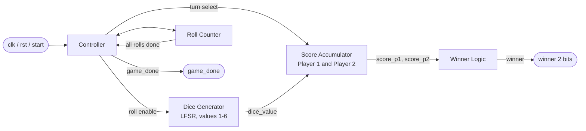
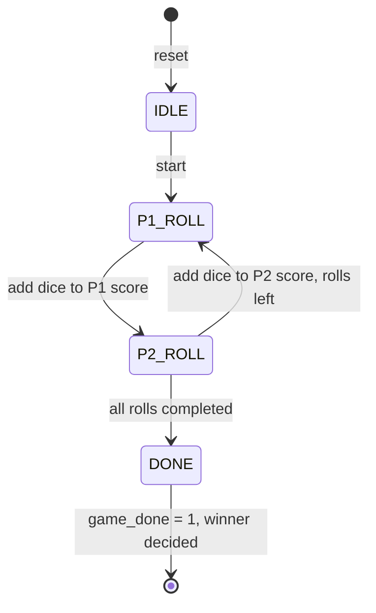
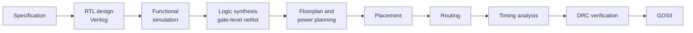

# 🎲 Two-Player Electronic Dice Game: RTL to GDSII


A two-player dice game designed in **Verilog HDL** and implemented through the **complete RTL-to-GDSII flow**. A digital dice built on an **LFSR (Linear Feedback Shift Register)** produces pseudo-random values from 1 to 6. The two players roll alternately for a fixed number of rolls, their totals are compared, and the higher total wins.

This README walks through the project topic by topic, from the idea and the architecture to simulation, physical design and verification.

---

## Table of Contents

1. [Project Overview](#1-project-overview)
2. [Key Features](#2-key-features)
3. [Functional Requirements](#3-functional-requirements)
4. [Game Rules](#4-game-rules)
5. [Top-Level Architecture](#5-top-level-architecture)
6. [Interface: Signals and Ports](#6-interface-signals-and-ports)
7. [Module-by-Module Description](#7-module-by-module-description)
8. [How the LFSR Dice Works](#8-how-the-lfsr-dice-works)
9. [Game Flow and Control Logic](#9-game-flow-and-control-logic)
10. [Functional Simulation and Verification](#10-functional-simulation-and-verification)
11. [RTL-to-GDSII Design Flow](#11-rtl-to-gdsii-design-flow)
12. [Physical Design: Layout](#12-physical-design-layout)
13. [Design Rule Check (DRC)](#13-design-rule-check-drc)
14. [Results Summary](#14-results-summary)
15. [Suggested Repository Structure](#15-suggested-repository-structure)
16. [How to Simulate](#16-how-to-simulate)
17. [Skills Demonstrated](#17-skills-demonstrated)
18. [Possible Future Improvements](#18-possible-future-improvements)
19. [Author](#19-author)

---

## 1. Project Overview

Digital systems need a way to produce unpredictable-looking values, whether for games, test-pattern generation, or lightweight security features. This project uses that idea in a small, complete digital system: a **two-player dice game** that is fully synthesizable hardware rather than a software simulation.

The goal was twofold:

1. **Design** a clean, modular digital system in Verilog, with a dice generator, score storage, a roll counter, a controller and decision logic.
2. **Implement** that design physically by taking the RTL through the full chip-design flow, ending with a routed layout that passes design-rule checks.

The result is an end-to-end example of how a simple idea becomes a manufacturable layout.

---

## 2. Key Features

- 🎯 **Hardware random dice.** An LFSR generates pseudo-random values in the range 1 to 6.
- 👥 **Two players, alternate turns.** The controller switches turns automatically after every roll.
- 🔢 **Configurable roll count.** Each player rolls 5 times by default.
- 🏆 **Automatic winner decision.** The higher total wins, and equal totals give a draw.
- 📟 **Simple 2-bit result code.** `winner` encodes Player 1 win, Player 2 win or draw.
- ✅ **`game_done` flag.** It rises when every roll has been completed.
- 🧩 **Modular design.** Each function lives in its own module, which makes it easy to test and reuse.
- 🧱 **Physically implemented.** The design is placed, routed and checked in Cadence Innovus.

---

## 3. Functional Requirements

| # | Requirement |
|---|---|
| 1 | The system simulates a two-player dice game. |
| 2 | Players roll the dice **alternately**. |
| 3 | The dice generates pseudo-random values between **1 and 6** using an LFSR. |
| 4 | Each player rolls **5 times** by default. |
| 5 | After all rolls, the two total scores are compared. |
| 6 | The player with the **higher total** is declared the winner. |
| 7 | If both totals are equal, the result is a **draw**. |
| 8 | All operations are synchronised by a **clock** and a **reset**. |
| 9 | The result is shown on a **2-bit `winner` output**. |
| 10 | The **`done`/`game_done`** output goes high when all rolls are completed. |

**Winner encoding**

| `winner[1:0]` | Meaning |
|---|---|
| `2'b01` | Player 1 wins |
| `2'b10` | Player 2 wins |
| `2'b00` | Draw |

---

## 4. Game Rules

1. The game starts after reset when `start` is asserted.
2. Player 1 rolls first, then Player 2, and they keep alternating.
3. Each roll produces a value from 1 to 6, which is added to the current player's total.
4. After 5 rolls each (10 rolls in total), the game ends and `game_done` goes high.
5. The totals are compared:
   - Player 1 total **>** Player 2 total, so **Player 1 wins**.
   - Player 2 total **>** Player 1 total, so **Player 2 wins**.
   - Totals equal, so **draw**.

**Score range.** The highest possible total per player is 5 × 6 = 30, and the lowest is 5 × 1 = 5. The 8-bit score registers (0 to 255) therefore hold any total with a lot of room to spare, which also leaves space for a larger number of rolls.

---

## 5. Top-Level Architecture

The design is modular. Each block does one job, and the top-level wrapper connects them.



| Module | Responsibility |
|---|---|
| **Dice Generator** | Produces pseudo-random dice values (1 to 6) using an LFSR shift register |
| **Score Accumulator** | Stores both players' scores and adds the dice value to whoever's turn it is |
| **Controller** | Coordinates the whole game: tracks the roll number, switches turns, enables score updates and signals completion |
| **Roll Counter** | Counts total rolls and manages turn switching |
| **Winner Logic** | Compares the final totals and decides win or draw |
| **Top-Level Wrapper** | Connects all modules and handles the overall inputs and outputs |

---

## 6. Interface: Signals and Ports

Signals observed in the design and its simulation:

| Signal | Width | Direction | Description |
|---|---|---|---|
| `clk` | 1 | Input | System clock; all sequential logic runs on it |
| `rst` | 1 | Input | Reset; clears scores, counters and control state |
| `start` | 1 | Input | Starts the game after reset |
| `dice_value` | 3 | Output / internal | Current dice value (1 to 6) |
| `roll_p1` | 1 | Output / internal | High while it is Player 1's turn to roll |
| `roll_p2` | 1 | Output / internal | High while it is Player 2's turn to roll |
| `score_p1` | 8 | Output / internal | Running total for Player 1 |
| `score_p2` | 8 | Output / internal | Running total for Player 2 |
| `game_done` | 1 | Output | High when all rolls are complete |
| `winner` | 2 | Output | Result code (`01` P1, `10` P2, `00` draw) |

---

## 7. Module-by-Module Description

### 7.1 Dice Generator (LFSR)
Creates the "random" number for every roll. It is built from a shift register with XOR feedback, which cycles through a long pseudo-random sequence. The register output is constrained so that the dice value is always between **1 and 6** (see [Section 8](#8-how-the-lfsr-dice-works)). It is clocked only when a roll is requested, so each roll picks up a new value from the sequence.

### 7.2 Score Accumulator
Holds **two registers**, one per player. When the controller enables an update, the module adds the current `dice_value` to the register of the player whose turn it is. The other player's score is left unchanged. On reset, both scores clear to zero.

### 7.3 Roll Counter
Counts how many dice rolls have happened in total. It also provides the turn information, since an even or odd roll count tells whether Player 1 or Player 2 rolls next. When the count reaches the target (10 rolls, which is 5 per player), it tells the controller that the game is over.

### 7.4 Controller
The brain of the system. On every clock edge it decides what happens next:
- waits for `start`;
- issues a roll request to the dice generator;
- enables the score update for the correct player;
- advances the roll counter and switches turns;
- raises `game_done` after the final roll.

### 7.5 Winner Logic
A comparator block. It compares `score_p1` against `score_p2` and drives the 2-bit `winner` output: Player 1 greater, Player 2 greater, or equal (draw). The result is final once `game_done` is high.

### 7.6 Top-Level Wrapper
Instantiates all of the modules above, wires their signals together, and exposes only the system's real inputs (`clk`, `rst`, `start`) and outputs (`winner`, `game_done`, and the score and dice signals). It is the module taken through the physical design flow.

---

## 8. How the LFSR Dice Works

**What is an LFSR?** A Linear Feedback Shift Register is a chain of flip-flops whose input is an XOR of selected earlier bits (the "taps"). On every clock edge the register shifts and the XOR result is fed back in. With well-chosen taps, the register walks through a long sequence of different states that *looks* random, but is completely deterministic and repeatable.

**Why use one for a dice?**
- Very small hardware: a few flip-flops plus an XOR gate.
- Fast: one new value per clock.
- Fully synthesizable, with no memory or processor needed.
- Deterministic, so the same seed always gives the same game, which makes verification easy.

**Getting 1 to 6 from a binary register.** A 3-bit value can represent 0 to 7, but a die only has the values 1 to 6. The generator therefore makes sure the all-zeros and the out-of-range value are never shown as a roll, so every `dice_value` is a valid face from 1 to 6. In the waveform, `dice_value[2:0]` only ever shows values between 1 and 6.

**Note on randomness.** An LFSR is *pseudo*-random. That is perfectly fine for a game, but it is not suitable for cryptographic use.

---

## 9. Game Flow and Control Logic



*This diagram shows the game flow at a conceptual level, as the sequence of phases the controller steps through. See the RTL for the exact state encoding.*

**Sequence in words**
1. **Idle.** After reset, scores are zero and the system waits for `start`.
2. **Player 1 rolls.** `roll_p1` goes high, a dice value is generated and added to `score_p1`.
3. **Player 2 rolls.** `roll_p2` goes high, a dice value is generated and added to `score_p2`.
4. **Repeat** until each player has rolled the required number of times (5 by default).
5. **Done.** `game_done` rises and the winner logic's result is final.

---

## 10. Functional Simulation and Verification

<p align="center">
  
</p>

The testbench was simulated with Cadence tools and the waveform above was captured. The clock period is 10 time units, the run lasts 250 ns, and one full game fits in that window.

### What each signal shows

| Signal | What to look for |
|---|---|
| `clk` | A steady clock driving all of the logic |
| `rst` | Held high at the beginning, then released so the game can begin |
| `start` | A short pulse that launches the game |
| `dice_value[2:0]` | Changes on every roll, and stays within 1 to 6 |
| `roll_p1`, `roll_p2` | Take turns going high, showing strict alternation between the two players |
| `score_p1[7:0]` | Steps up after each Player 1 roll |
| `score_p2[7:0]` | Steps up after each Player 2 roll |
| `game_done` | Rises near the end of the run, after the last roll |
| `winner[1:0]` | Final result code |

### Score progression (read from the waveform)

| Roll # | 0 | 1 | 2 | 3 | 4 | 5 |
|---|---|---|---|---|---|---|
| **Player 1 total** | 0 | 1 | 2 | 5 | 10 | **16** (`0x10`) |
| **Player 2 total** | 0 | 4 | 8 | 9 | 14 | **15** (`0x0F`) |

Each player's score changes exactly **5 times**, which matches the default of 5 rolls per player.

### Result

Final scores are **Player 1 = 16** and **Player 2 = 15**, so the correct outcome is **Player 1 wins**, and `winner` settles to `2'b01` once the game is over. This agrees with the expected behaviour in the functional requirements.

> The `winner` signal is a continuous comparison of the two running scores, so it can change while the game is in progress (for example, it briefly shows Player 2 ahead mid-game). It becomes the **official result only when `game_done` is high**.

### What the simulation confirms
- ✅ Reset and start behave correctly.
- ✅ Turns alternate strictly between Player 1 and Player 2.
- ✅ Dice values remain in the 1 to 6 range.
- ✅ Scores accumulate correctly for each player.
- ✅ The game ends after the correct number of rolls, with `game_done` asserted.
- ✅ The winner is decided correctly from the final scores.

---

## 11. RTL-to-GDSII Design Flow

The project goes beyond RTL coding and covers the whole path from description to layout.



| Stage | What happens |
|---|---|
| **Specification** | Define the game rules and the interface |
| **RTL design** | Write the modules in Verilog HDL |
| **Functional simulation** | Check the behaviour with a testbench and waveforms |
| **Logic synthesis** | Convert the RTL into a netlist of standard cells (the placed layout shows register instances such as `score_p1_reg`, `dice_value_reg` and `game_done_reg`) |
| **Floorplan and power planning** | Define the core area, I/O pin placement, and the power ring and stripes |
| **Placement** | Position the standard cells in rows inside the core |
| **Routing** | Connect all of the cells with metal layers |
| **Timing analysis** | Check that the paths meet the clock requirement |
| **DRC verification** | Confirm that the layout obeys the manufacturing design rules |
| **GDSII** | The final layout database used for fabrication |

**Tools:** Cadence tools for simulation, and **Cadence Innovus** for place and route and layout verification.

<!--
================= TIMING SECTION (enable after verification) =================
The timing screenshot (assets/dice-timing-report.jpg) shows startpoints h0[..] and
endpoints y_out[..], which are not signals of the dice game. Confirm the screenshot
belongs to THIS design (or replace it with the dice design's report), then uncomment.

### Timing Analysis

<p align="center">
  
</p>

Summary from the report: 13 total paths, 13 passing, 0 failing, WNS = 0.000, TNS = 0.000.
===============================================================================
-->

---

## 12. Physical Design: Layout

<p align="center">
  
</p>

The image shows the finished layout in the **Cadence Innovus** layout window.

**What you can see**

| Element | Description |
|---|---|
| **Core area** | The central region filled with rows of placed standard cells |
| **Standard cells and registers** | Labels in the cells include `score_p1`, `score_p2`, `dice_value` and `game_done`, which are the flip-flops implementing the game's state |
| **Power ring** | The rectangular frame surrounding the core, delivering power to the design |
| **Power stripes** | The regularly spaced vertical and horizontal stripes that distribute power across the core |
| **Signal routing** | The dense mesh of coloured wires on multiple metal layers connecting the cells |
| **I/O pins** | The pin groups along the **left and right edges** of the block, which are the design's inputs and outputs |
| **Layer panel** | The right-hand panel lists the process layers (poly, contact, metals and vias) used to display and control the view |

**Why this matters.** This is the moment the design stops being code and becomes a physical object: every flip-flop and gate has a real location, and every signal has a real wire.

---

## 13. Design Rule Check (DRC)

<p align="center">
  
</p>

`check_drc` was run in the Innovus terminal. The log shows the verification stages (initialising, deleting existing violations, creating sub-areas and verifying) and ends with:

```
Verification Complete : 0 Viols.
```

- **Checked area:** `{0.000 0.000 45.200 43.700}`, roughly **45.2 µm × 43.7 µm**, which is about **1975 µm²**.
- **Result:** **0 violations**, so the layout is DRC-clean.

A DRC-clean layout means the geometry (spacing, width, via rules and so on) respects the manufacturing rules of the process.

---

## 14. Results Summary

| Item | Result |
|---|---|
| Language | Verilog HDL |
| Dice generation | LFSR-based, values 1 to 6 |
| Players / rolls | 2 players, 5 rolls each (default) |
| Functional simulation | Correct alternation, scoring, completion and winner |
| Example game result | Player 1 = 16, Player 2 = 15, so Player 1 wins (`2'b01`) |
| Layout (Innovus) | Fully placed and routed |
| Checked layout area | ≈ 45.2 × 43.7 µm (≈ 1975 µm²) |
| DRC | **0 violations** |

---

## 15. Suggested Repository Structure

```
electronic-dice-game-rtl-to-gdsii/
├── rtl/                 # Verilog source files (dice generator, score, counter, controller, winner logic, top)
├── tb/                  # Testbench
├── sim/                 # Simulation scripts and waveform captures
├── pnr/                 # Place-and-route scripts / reports
├── assets/              # Images used in this README
└── README.md
```

*Adjust the folder names to match your actual files.*

---

## 16. How to Simulate

The exact commands depend on your tool and file names. Two examples (replace the file names with yours):

**Cadence (Xcelium)**
```bash
xrun -access +rwc rtl/*.v tb/tb_dice_game.v -gui
```

**Open-source (Icarus Verilog + GTKWave)**
```bash
iverilog -o dice_sim rtl/*.v tb/tb_dice_game.v
vvp dice_sim
gtkwave dump.vcd
```

Watch for: `rst` releasing, `start` pulsing, alternating `roll_p1`/`roll_p2`, the two scores climbing, then `game_done` and `winner`.

---

## 17. Skills Demonstrated

- Verilog HDL and modular RTL design
- LFSR-based pseudo-random number generation
- Controller / finite-state-machine design
- Testbench-driven functional verification and waveform analysis
- RTL-to-GDSII flow: synthesis, floorplan, placement, routing
- Physical verification with DRC in Cadence Innovus

---

## 18. Possible Future Improvements

- Drive a **7-segment display** and buttons and prototype on an **FPGA**.
- Make the **number of rolls** a parameter or an input.
- Support **more than two players**.
- Add a **tie-break roll** instead of ending in a draw.
- Allow a **user-supplied seed** for the LFSR.
- Run **gate-level simulation** and **multi-corner timing analysis**.
- Add **LVS** and power/area reports to complete the sign-off checks.

---

## 19. Author

**K. Rajeswaran** · Final-year ECE student, VIT Vellore

- 💼 [LinkedIn](https://www.linkedin.com/in/rajeswaran-k-4712a1317)
- 📧 [rajeswarank333@gmail.com](mailto:rajeswarank333@gmail.com)
